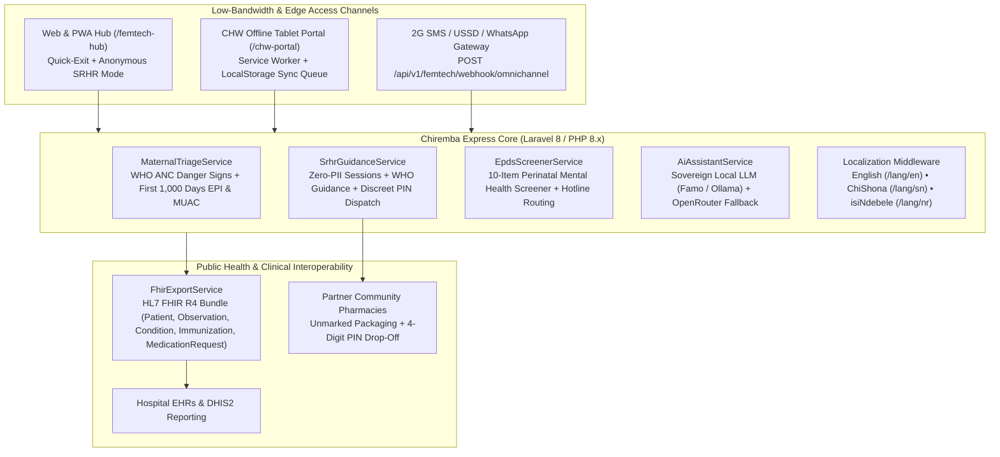

# Chiremba Express Core (Femtech & Maternal/Child Health Platform)

[](https://opensource.org/licenses/MIT)
[](https://www.unicef.org/innovation/venturefund)
[](https://hl7.org/fhir/R4/)
[]()

> **Open-source, privacy-first AI clinical triage engine, Maternal/Child Health (First 1,000 Days) tracker, Confidential SRHR portal, Offline-First Community Health Worker (CHW) edge module, and HL7/FHIR R4 telemedicine interoperability layer engineered for low-bandwidth environments.**

---

## 🌍 Overview & Problem Statement

In emerging markets across Sub-Saharan Africa, women, expectant mothers, and adolescent girls face severe systemic bottlenecks when accessing essential healthcare—including acute specialist deficits, long rural transit times, financial barriers, and social stigma surrounding sexual and reproductive health and rights (SRHR) and perinatal mental health.

**Chiremba Express Core** transforms standard telemedicine into a **Digital Public Good (DPG)** tailored to **UNICEF Venture Fund (Femtech)** priorities:

* **Pillar 1 — Maternal & Antenatal Health Tracking:**
  * **Gestational Milestone & Danger-Sign Triage:** Automated WHO Antenatal Care (ANC) rule-based + AI workflow where expectant mothers or nurses input gestational age, blood pressure, and symptoms (`severe_headache`, `blurred_vision`, `sudden_swelling`, `vaginal_bleeding`, `reduced_fetal_movement`, `convulsions`). Automatically flags **Pre-eclampsia**, **Gestational Hypertension**, **Threatened Miscarriage / Antepartum Haemorrhage**, and **Fetal Distress**, prioritizing urgent specialist referral.
  * **First 1,000 Days Vaccination & Growth Tracker:** Automated WHO/EPI infant immunization schedule generation (`BCG`, `OPV`, `Pentavalent 1–3`, `PCV`, `Rotavirus`, `Vitamin A`, `Measles-Rubella 1–2`), **MUAC (Mid-Upper Arm Circumference)** malnutrition screening (`SAM` / `MAM` / `Normal`), and automated SMS/WhatsApp reminders.
  * **Maternal Vitals Log:** Lightweight dashboard for blood pressure (`systolic`/`diastolic`), weight, blood glucose, and fetal heart rate trends—exportable as an **HL7/FHIR R4 JSON Bundle**.
* **Pillar 2 — Confidential Sexual & Reproductive Health (SRHR) Portal:**
  * **Discreet / Anonymous Mode & Quick-Exit Safety Button:** 1-click `Quick Exit (ESC)` privacy button that wipes local state and redirects immediately, plus zero-PII anonymous session tokens (`ANON-XXXXXX`) for stigma-free consultations.
  * **Plain-Language Reproductive Health Assistant:** Calibrated against **WHO Family Planning & SRHR Guidelines** covering emergency contraception, daily/long-acting contraceptives, menstrual health, fertility, and STI self-testing in plain language.
  * **Confidential Courier Packaging Flag:** E-pharmacy dispatch toggle instructing partner pharmacies to package SRHR supplies (contraceptives, emergency contraception, menstrual cups, pregnancy tests, HIV/Syphilis self-test kits) in **unmarked wrapping with 4-digit PIN-verified doorstep drop-off**.
* **Pillar 3 — Frontline Community Health Worker (CHW) Mode:**
  * **Proxy Patient Intake:** Tablet/mobile interface enabling village health workers (VHWs) and community nurses to triage and schedule appointments on behalf of low-literacy or unconnected rural patients.
  * **Offline-First Edge Data Caching:** Powered by Service Workers (`/sw-chw-offline.js`) and `localStorage` edge queues (`chiremba_chw_offline_queue_v1`) so maternal checklists and proxy intakes work with **zero internet connectivity** and automatically batch-sync (`POST /api/v1/femtech/chw/sync`) when network access is restored.
* **Pillar 4 — Maternal Mental Health Screening (EPDS):**
  * **Digitized Edinburgh Postnatal Depression Scale (EPDS):** Conversational 10-question perinatal mental health screener (scored `0–30`) with self-harm safety net detection (Item 10). Automatically surfaces certified mental health counselors and free 24/7 psychosocial support hotlines (e.g., *Friendship Bench Zimbabwe*, *Lifeline 116*) when scores indicate distress (`>= 10`).
* **Pillar 5 — Technical & Public Health Interoperability Layer:**
  * **HL7/FHIR R4 Diagnostic Export:** Standardized FHIR R4 JSON `Bundle` schemas (`Patient`, `Observation` with LOINC codes `85354-9` / `8480-6` / `8462-4` / `29463-7` / `2339-0` / `75275-8`, `Condition`, `Immunization`, `MedicationRequest`) for seamless integration with hospital EHRs and **DHIS2** public health reporting systems, including de-identified export (`?anonymize=1`).
  * **Multilingual Localization (`en`, `sn`, `nr`):** Built-in localization files for **English** (`resources/lang/en/femtech.php`), **ChiShona** (`resources/lang/sn/femtech.php`), and **isiNdebele** (`resources/lang/nr/femtech.php`) across all core maternal triage and EPDS screening workflows.
  * **Conversational / Low-Bandwidth Gateway:** Omnichannel webhook (`POST /api/v1/femtech/webhook/omnichannel`) enabling 2G SMS, USSD, and WhatsApp maternal triage (`TRIAGE 32 HEADACHE VISION BP 155/100`) and SRHR guidance (`SRHR emergency contraception`).

---

## 🏛️ System Architecture



### Core Directory Structure

| Module / Path | Responsibility |
| :--- | :--- |
| `app/Services/MaternalTriageService.php` | WHO Antenatal danger-sign rule engine (Pre-eclampsia, Haemorrhage, Fetal Distress), First 1,000 Days EPI vaccine generator, and WHO MUAC child nutrition evaluator |
| `app/Services/SrhrGuidanceService.php` | Zero-PII anonymous SRHR session manager, WHO-calibrated reproductive health assistant (`en`/`sn`/`nr`), and 4-digit PIN discreet courier packaging flagger |
| `app/Services/EpdsScreenerService.php` | Digitized 10-question Edinburgh Postnatal Depression Scale (EPDS) scorer and psychosocial hotline router |
| `app/Services/FhirExportService.php` | HL7 FHIR R4 (`v4.0.1`) Bundle generator with LOINC/CVX coding and DHIS2 de-identification support |
| `app/Http/Controllers/Patient/FemtechController.php` | Web & REST API controller for all 5 UNICEF Femtech pillars and the omnichannel SMS/USSD webhook |
| `resources/views/user/patient/femtech_hub.blade.php` | Unified Maternal, First 1,000 Days, Confidential SRHR & EPDS web interface with `ESC` Quick-Exit privacy safety |
| `resources/views/user/chw_portal.blade.php` & `public/sw-chw-offline.js` | Offline-first Community Health Worker (CHW) proxy patient intake portal and Service Worker cache |
| `resources/lang/{en,sn,nr}/femtech.php` | Multilingual clinical translations for English, ChiShona (`sn`), and isiNdebele (`nr`) |
| `database/migrations/` & `database/seeders/` | Idempotent schema migrations and `FemtechUnicefDemoSeeder` for out-of-the-box evaluation |
| `tests/Unit/` & `tests/Feature/` | Automated PHPUnit test suite verifying migrations, seeders, and all 5 clinical/interoperability pillars |

---

## 🚀 Quickstart & Installation Instructions

### Prerequisites
* **PHP:** `>= 8.1` (tested on PHP `8.1` – `8.3` with `pdo_sqlite` / `pdo_mysql`, `mbstring`, `openssl`, `json`)
* **Composer:** `>= 2.x`
* **Database:** MySQL `5.7+` / MariaDB `10.4+` **or** SQLite (zero-config SQLite supported out of the box)
* **Node.js & NPM:** Optional (compiled assets are included in `public/css` and `public/js`)

### Step-by-Step Setup

1. **Clone the Repository:**
   ```bash
   git clone https://github.com/DigitalVocano/chiremba-express-core.git
   cd chiremba-express-core
   ```

2. **Install PHP Dependencies:**
   ```bash
   composer install --ignore-platform-reqs
   ```

3. **Configure Environment Variables:**
   ```bash
   cp .env.example .env
   php artisan key:generate
   ```
   > **Tip (Zero-Config SQLite Setup):** To run immediately without configuring a MySQL server, set `DB_CONNECTION=sqlite` in `.env` and create an empty file at `database/database.sqlite`.

4. **Run Database Migrations & Seed Demo Data:**
   ```bash
   php artisan migrate --seed
   ```
   This executes all core and Femtech migrations and runs both `DemoAccountsSeeder` and `FemtechUnicefDemoSeeder`, populating demo expectant mothers, OB/GYN specialists, discreet SRHR pharmacies, First 1,000 Days infant vaccine schedules, CHW proxy intakes, and EPDS screenings.

5. **Start the Local Development Server:**
   ```bash
   php artisan serve
   ```
   * **Main Application:** `http://localhost:8000`
   * **Maternal, Child & Confidential SRHR Hub:** `http://localhost:8000/femtech-hub`
   * **Offline-First CHW Proxy Intake Portal:** `http://localhost:8000/chw-portal`
   * **HL7/FHIR R4 JSON Diagnostic Bundle Export:** `http://localhost:8000/api/v1/femtech/fhir/patient/1`

### Demo Credentials (Seeded via `php artisan db:seed`)

| Role | Phone / Login | Password / OTP | Notes |
| :--- | :--- | :--- | :--- |
| **Expectant Mother (Patient)** | `0771234567` (`patientdemo@chiremba.com`) | `123456` | Pre-loaded with 30-week antenatal profile, vitals, & infant EPI tracker |
| **OB/GYN Specialist** | `0772000111` (`maternal.specialist@chiremba.com`) | `123456` | Receives urgent maternal danger-sign referrals |
| **Discreet SRHR Pharmacy** | `0772000222` (`srhr.pharmacy@chiremba.com`) | `123456` | Processes unmarked, PIN-verified SRHR deliveries |
| **General Demo Doctor** | `0771234568` (`doctordemo@chiremba.com`) | `123456` | Standard telemedicine consultation account |

---

## 🧪 Running the Automated Test Suite

The repository includes a self-contained **PHPUnit** test suite configured to run against an in-memory SQLite database (`:memory:`), verifying all migrations, seeders, and the 5 UNICEF Femtech & Maternal/Child Health modules:

```bash
./vendor/bin/phpunit --testdox
```

### What the Test Suite Verifies:
1. **Unit Tests (`tests/Unit/MaternalTriageAndEpdsTest.php`):**
   * Rule-based detection of **Pre-eclampsia Risk** (`severe_headache` + `blurred_vision` + `sudden_swelling` + elevated BP) and automatic urgent referral flagging.
   * Early pregnancy (`< 20 weeks`) vaginal bleeding + abdominal pain flagging **Threatened Miscarriage / Ectopic Pregnancy Risk**.
   * **WHO MUAC Child Nutrition Screening** thresholds (`< 11.5 cm` SAM, `11.5–12.4 cm` MAM, `>= 12.5 cm` Normal).
   * Natural-language SRHR topic classification across English, ChiShona, and isiNdebele keywords.
   * Localization of the 10-item **EPDS** questionnaire in English (`en`), ChiShona (`sn`), and isiNdebele (`nr`).
2. **Feature & Integration Tests (`tests/Feature/UnicefFemtechModulesTest.php`):**
   * Clean execution of all database migrations and `DatabaseSeeder` (`DemoAccountsSeeder` + `FemtechUnicefDemoSeeder`).
   * `POST /api/v1/femtech/maternal/triage` — Gestational danger-sign triage and automatic priority appointment creation.
   * `POST /api/v1/femtech/child/schedule` — First 1,000 Days infant registration and 9-milestone WHO/EPI vaccine schedule generation.
   * `POST /api/v1/femtech/srhr/anonymous-session`, `/assistant`, and `/discreet-order` — Zero-PII anonymous session creation, WHO-calibrated guidance, and unmarked courier dispatch with 4-digit PIN generation.
   * `POST /api/v1/femtech/chw/sync` — Offline-first CHW proxy patient intake batch synchronization.
   * `POST /api/v1/femtech/epds/screen` — Postpartum depression screening and automatic surfacing of psychosocial crisis hotlines.
   * `GET /api/v1/femtech/fhir/patient/{id}` & `POST /api/v1/femtech/webhook/omnichannel` — HL7/FHIR R4 Bundle export and 2G SMS/USSD triage webhook processing.

---

## 🔌 Open API & Interoperability Reference (`/api/v1/femtech`)

| Method | Endpoint | Description |
| :--- | :--- | :--- |
| `POST` | `/api/v1/femtech/maternal/triage` | Evaluate gestational age, vitals & danger signs; auto-routes urgent referrals |
| `POST` | `/api/v1/femtech/maternal/vitals` | Log maternal BP (`systolic`/`diastolic`), weight, blood glucose, and fetal heart rate |
| `POST` | `/api/v1/femtech/child/schedule` | Register infant and generate First 1,000 Days WHO/EPI vaccine & nutrition milestones |
| `POST` | `/api/v1/femtech/child/reminder/{id}` | Trigger SMS/WhatsApp immunization & nutrition check-in reminder |
| `POST` | `/api/v1/femtech/srhr/anonymous-session` | Generate a zero-PII anonymous session token (`ANON-XXXXXX`) |
| `POST` | `/api/v1/femtech/srhr/assistant` | Query the WHO-calibrated Plain-Language Reproductive Health Assistant (`en`/`sn`/`nr`) |
| `POST` | `/api/v1/femtech/srhr/discreet-order` | Dispatch an unmarked SRHR pharmacy order with a 4-digit doorstep verification PIN |
| `POST` | `/api/v1/femtech/chw/sync` | Batch-sync offline-cached Community Health Worker (CHW) proxy patient intakes |
| `POST` | `/api/v1/femtech/epds/screen` | Submit 10-item EPDS maternal mental health screening and retrieve crisis hotlines |
| `GET` | `/api/v1/femtech/fhir/patient/{id}` | Export HL7/FHIR R4 JSON Bundle (`?anonymize=1` for de-identified DHIS2 export) |
| `POST` | `/api/v1/femtech/webhook/omnichannel` | Low-bandwidth SMS / USSD / WhatsApp webhook (`TRIAGE ...` / `SRHR ...`) |

---

## 🤝 Contributing & Digital Public Good Governance

We welcome contributions from clinicians, public health researchers, community health workers, and open-source developers:
1. Fork the repository and create a feature branch (`git checkout -b feat/maternal-module`).
2. Ensure all clinical triage rules cite WHO or national Ministry of Health guidelines.
3. Run `./vendor/bin/phpunit` to verify all tests pass before opening a Pull Request.

---

## 📄 License

This project is open-sourced as a Digital Public Good under the **[MIT License](LICENSE)**. Copyright (c) 2026 Digital Vocano.

